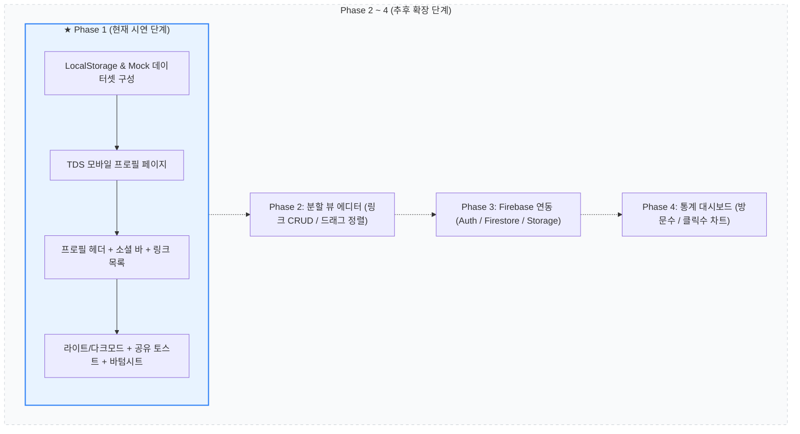

# [PRD] 마이링크 (MyLink) - 제품 요구사항 정의서 (v2.0)
> **시연(Demo) 특화 단계별 개발 가이드**  
> 현재 단계(Phase 1)는 **복잡한 대시보드, 통계, 분할 뷰 에디터, 백엔드를 제외**하고, **LocalStorage와 Mock 데이터를 활용한 완성도 높은 TDS 프로필 페이지** 구축에 집중합니다.

---

## 1. 프로젝트 개요 (Overview)

### 1.1 서비스 정의
- **서비스명**: 마이링크 (MyLink)
- **개념**: 여러 소셜 미디어, 포트폴리오, 블로그 링크를 하나의 정갈한 모바일 페이지로 제공하는 **링크트리 클론 서비스**
- **시연(Demo) 전략**: 처음부터 서버나 복잡한 어드민을 구축하지 않고, **1단계로 LocalStorage 기반의 매력적인 프로필 페이지**를 완성하여 핵심 사용자 경험을 즉시 시연한 뒤, 점진적으로 에디터와 클라우드 DB를 확장

### 1.2 디자인 철학
- **"shadcn/ui로 구현, TDS처럼 보이게"**: 이 프로젝트의 디자인 방향은 **shadcn/ui를 엔지니어링 기반**으로, **토스 디자인 시스템(TDS)을 시각적 목표**로 삼는다. shadcn/ui가 제공하는 컴포넌트 구조·접근성·Radix UI 기반 동작을 활용하되, 컴포넌트의 색상·타이포그래피·여백·모서리·그림자 등 모든 시각적 표현은 `design.md`에 정의된 TDS 규격을 따른다.
- **shadcn/ui 컴포넌트 시스템**: 모든 UI 컴포넌트는 `npx shadcn@latest add <component>` 명령으로 추가하고, `src/components/ui/`에서 직접 소스를 수정하여 TDS 스타일로 커스터마이징한다.
- **TDS 토큰으로 shadcn/ui 기본 테마 재정의**: shadcn/ui의 기본 CSS variables(`--primary`, `--radius`, `--border` 등)를 TDS 토큰(`design.md`의 토스 블루·그레이스케일·둥근 모서리·그림자 등)으로 덮어써서, shadcn/ui 컴포넌트가 기본 외관이 아닌 TDS 외관으로 렌더링되도록 한다. 토큰은 `globals.css`의 `@theme inline` 블록 및 `:root` / `.dark` 블록에서 관리한다.
- **단일 모바일 셸(Shell)**: 데스크톱 화면에서도 모바일 디바이스 규격(최대 430px)의 깔끔한 중앙 셸 레이아웃 제공

---

## 2. 단계별 개발 로드맵 (Staged Roadmap)



| 단계 | 목표 범위 | 주요 내용 | 현 상태 |
|------|-----------|-----------|---------|
| **Phase 1** | **LocalStorage 기반 프로필 페이지** | • 대시보드/통계/분할 뷰 제외<br>• LocalStorage 데이터 기반 단일 프로필 뷰<br>• TDS 디자인 토큰 및 다크모드, 바텀시트 | **🎯 현재 진행 대상** |
| **Phase 2** | **로컬 에디터 & 분할 뷰** | • 데스크톱 분할 뷰 에디터<br>• 링크 추가/수정/삭제/드래그앤드롭 정렬 | 추후 진행 |
| **Phase 3** | **Firebase BaaS 전환** | • Firebase Auth(소셜/이메일), Firestore, Storage<br>• `/@username` 다중 사용자 SaaS 전환 | 추후 진행 |
| **Phase 4** | **통계 및 분석 고도화** | • 링크별 클릭 카운팅, 7일/30일 추이 차트 | 추후 진행 |

---

## 3. 사용자 시나리오 (User Scenarios)

### 시나리오 1: [시연자] 첫 접속 및 로컬 데이터 자동 시딩 (First Visit & Seeding)
- **페르소나**: 개발자 양민주 (시연자)
- **목표**: 별도의 회원가입이나 백엔드 없이 접속 즉시 완성된 TDS 프로필 뷰를 확인하고 시연을 진행한다.
- **진행 흐름**:
  1. 시연자가 브라우저에서 마이링크 URL에 접속한다.
  2. 시스템은 `localStorage`에 기존 데이터가 있는지 확인하고, 없을 경우 `mockData.ts`의 기본 프로필(이름, 소개, 4개 링크, 소셜 아이콘)을 로컬에 자동 시딩한다.
  3. 최대 430px 너비의 모바일 프레임 안에 TDS 규격의 깔끔한 프로필 카드가 렌더링된다.
  4. 상단 우측의 [테마 버튼]을 클릭하여 부드럽게 라이트 모드 ↔ 다크 모드로 전환되는 것을 확인한다.

### 시나리오 2: [방문자/채용담당자] 프로필 탐색 및 주요 링크 확인 (Browsing & Links)
- **페르소나**: IT 기업 채용 담당자 김토스
- **목표**: 인스타그램이나 이력서에 링크된 지원자의 마이링크 페이지를 열람하고 역량을 파악한다.
- **진행 흐름**:
  1. 지원자의 마이링크에 접속하여 프로필 사진과 직무("Frontend Developer"), 상태 뱃지("새로운 기회와 커피챗을 기다려요")를 확인한다.
  2. '대표작' 태그와 토스 블루 배경으로 강조된 [프로젝트 포트폴리오] 링크를 클릭하여 새 탭에서 포트폴리오 사이트를 확인한다.
  3. 이어서 [GitHub], [기술 블로그], [이력서] 링크를 차례로 확인하고, 소셜 아이콘 바에서 깃허브 아이콘을 탭해 즉시 이동한다.

### 시나리오 3: [방문자/네트워커] 링크 공유 및 커피챗 바텀시트 제안 (Share & Bottom Sheet)
- **페르소나**: 협업 기회를 제안하려는 동료 개발자 박협업
- **목표**: 프로필 링크를 동료에게 공유하고, 간편하게 커피챗을 제안한다.
- **진행 흐름**:
  1. 상단 앱바의 [공유] 버튼을 탭한다. 네이티브 공유 창 또는 클립보드 복사가 수행되며 상단에 "프로필 링크가 복사되었어요" TDS 토스트 알림이 뜬다.
  2. 프로필 카드 내 [이메일 복사] 버튼을 누르면 이메일 주소가 복사되고 토스트 피드백을 받는다.
  3. 화면 최하단에 항상 떠 있는 고정 버튼 [함께 일하기 · 커피챗 제안]을 클릭한다.
  4. 배경에 반투명 스크림이 깔리며 TDS 바텀시트가 아래에서 부드럽게 올라온다.
  5. [메일 앱에서 작성하기]를 누르거나, 스크림 영역을 탭하여 바텀시트를 닫는다.

### 시나리오 4: [시연자] LocalStorage 조작을 통한 프로필 실시간 변경 시연
- **페르소나**: 개발자 양민주 (시연자)
- **목표**: 로컬스토리지 데이터를 수정하여 프로필 내용이 즉각 화면에 반영되는 것을 시연한다.
- **진행 흐름**:
  1. 브라우저 개발자 도구(F12) > Application > Local Storage의 `mylink_profile_data` 키를 연다.
  2. 이름(`name`)을 "김민주"로 바꾸거나 새 링크를 JSON 배열에 추가하고 저장한다.
  3. 페이지를 새로고침하면 변경된 데이터가 유지된 채 즉시 화면에 렌더링되는 영속성을 보여준다.

---

## 4. Phase 1 (현재 단계) 핵심 기능 요구사항

> ⚠️ **제외 항목 (Out of Scope for Phase 1)**:  
> - 관리자 대시보드 화면 및 분할 뷰 에디터  
> - 링크 추가/수정/삭제 폼 및 드래그 앤 드롭 정렬  
> - 서버/Firebase 통신 및 사용자 로그인/회원가입  
> - 일별 클릭/방문자 통계 차트 대시보드  

### 4.1 로컬 데이터 스토리지 및 Mock API (Data Layer)
1. **정적 Mock 데이터 파일 (`src/data/links.json`)**
   - 프로필 정보, 소셜 링크, 6개 대표 링크 목록(포트폴리오, 오픈소스, 기술블로그, 이력서, Figma 디자인 시스템, 커피챗)을 담은 단일 정적 소스 파일
2. **로컬 시딩 및 영속성 (Default Seed & Persistence)**
   - 최초 실행 시 브라우저 LocalStorage에 데이터가 없을 경우, `src/data/links.json` 기반의 기본 데이터를 자동으로 초기 로드
   - LocalStorage의 `mylink_profile_data` 키에서 프로필 정보를 읽어 화면을 렌더링
   - 사용자가 테마를 변경하거나 LocalStorage 값을 수정하면 즉시 화면에 반영
3. **백엔드 Mock API 엔드포인트 (Next.js Route Handlers)**
   - `GET /api/links`: 링크 목록 조회 (카테고리/하이라이트/키워드 필터링 지원)
   - `POST /api/links`: 신규 링크 등록 시뮬레이션
   - `GET /api/profile`: 프로필 + 소셜 + 링크 전체 조회
   - 표준 REST Envelope 구조(`success`, `statusCode`, `message`, `data`, `meta`)를 채택하여 추후 Phase 3 BaaS/백엔드 전환 시 프론트엔드 연동 변경 최소화

### 4.2 공개 프로필 페이지 구성 (Profile Page UX)

```
+------------------------------------------+
|  [상단 바] 로고 / 공유 버튼 / 테마 토글  |
|                                          |
|            [ 프로필 아바타 ]             |
|                이름/닉네임               |
|             직무 / 한 줄 소개            |
|            (상태 뱃지/칩)                |
|                                          |
|        [ 소셜 아이콘 바 (5종) ]          |
|                                          |
|      +----------------------------+      |
|      | [아이콘] 대표 링크 1    -> |      |
|      +----------------------------+      |
|      | [아이콘] 포트폴리오     -> |      |
|      +----------------------------+      |
|      | [아이콘] 깃허브 링크    -> |      |
|      +----------------------------+      |
|                                          |
|   [하단 고정 CTA 버튼 (예: 커피챗)]      |
+------------------------------------------+
```

1. **상단 앱바 (TopBar - 56px)**
   - 서비스 브랜드 인디케이터 (토스 블루 포인트)
   - 네이티브 공유 API(`navigator.share`) 또는 URL 복사 버튼 + TDS 토스트 알림
   - 라이트 모드 / 다크 모드 원클릭 토글 버튼
2. **메인 프로필 카드 (Profile Card)**
   - 원형 아바타 (그라디언트 배경 + 이니셜 또는 이미지) + 활동 상태 뱃지
   - 이름/닉네임, 직무 타이틀
   - 상태 배지(Chip) 표시 ("새로운 기회와 커피챗을 기다려요")
   - 소개 문구 (TDS 해요체 톤앤매너)
   - 보조 액션 버튼 (이메일 복사, 연락처 보기)
3. **소셜 아이콘 바 (Social Icons)**
   - 깃허브, 블로그, 이메일, 포트폴리오 등 주요 SNS 아이콘 링크
4. **주요 링크 목록 (TDS ListRow Card)**
   - 각 링크: 44px 둥근 아이콘, 타이틀, 서브타이틀, 태그 뱃지, 외부 링크 화살표
   - `highlight: true` 링크는 토스 블루 배경과 강조 태그로 시선 유도
   - 클릭 시 타겟 URL로 새 탭 열기
5. **인터랙션 및 바텀시트 (Bottom Sheet & CTA)**
   - 화면 최하단 고정 CTA ("함께 일하기 · 커피챗 제안")
   - 클릭 시 부드럽게 올라오는 TDS 스타일 바텀시트 (스크림 배경 + 연락처 옵션)

---

## 5. Phase 1 로컬스토리지 및 Mock API 데이터 구조 (Data Schema)

기본 더미 데이터는 [`src/data/links.json`](file:///e:/myLink_minju/mylink/src/data/links.json)에 정의되어 있으며, 브라우저의 `localStorage.getItem("mylink_profile_data")` 및 Mock API 응답의 기반 데이터로 사용됩니다.

### 5.1 프로필 및 링크 스키마 (`src/types/link.ts`)

```json
{
  "profile": {
    "name": "양민주",
    "jobTitle": "Frontend Developer",
    "initials": "MJ",
    "avatarUrl": "",
    "badge": "새로운 기회와 커피챗을 기다려요",
    "bio": "복잡한 비즈니스 로직을 사용자가 직관적으로 이해할 수 있는 정갈한 UI로 풉니다. 세밀한 인터랙션과 완성도 높은 디자인 시스템 구축을 좋아해요.",
    "email": "minju@example.com"
  },
  "socials": [
    { "platform": "github", "url": "https://github.com/yangminju" },
    { "platform": "blog", "url": "https://velog.io/@minju" },
    { "platform": "linkedin", "url": "https://linkedin.com/in/minju-yang" },
    { "platform": "mail", "url": "mailto:minju@example.com" }
  ],
  "links": [
    {
      "id": "link-1",
      "title": "프로젝트 포트폴리오",
      "subtitle": "직접 설계하고 개발한 웹 서비스 및 인터랙티브 인터페이스 모음",
      "tag": "대표작",
      "category": "featured",
      "url": "https://portfolio.example.com",
      "icon": "Portfolio",
      "highlight": true,
      "isExternal": true,
      "isActive": true,
      "clicks": 1420,
      "order": 1,
      "createdAt": "2026-01-15T09:00:00Z"
    },
    {
      "id": "link-2",
      "title": "GitHub 오픈소스 저장소",
      "subtitle": "디자인 시스템 컴포넌트 라이브러리 및 개인 사이드 프로젝트 소스",
      "tag": "Open Source",
      "category": "project",
      "url": "https://github.com/yangminju",
      "icon": "Github",
      "highlight": false,
      "isExternal": true,
      "isActive": true,
      "clicks": 892,
      "order": 2,
      "createdAt": "2026-02-01T11:30:00Z"
    },
    {
      "id": "link-3",
      "title": "기술 블로그 (Tech Log)",
      "subtitle": "성능 최적화, 웹 접근성, 토스 디자인 시스템(TDS) 구현기",
      "tag": "Weekly",
      "category": "content",
      "url": "https://velog.io/@minju",
      "icon": "Blog",
      "highlight": false,
      "isExternal": true,
      "isActive": true,
      "clicks": 654,
      "order": 3,
      "createdAt": "2026-02-18T14:20:00Z"
    },
    {
      "id": "link-4",
      "title": "이력서 및 경력기술서",
      "subtitle": "역할별 핵심 성과, 기술 스택, 팀 협업 히스토리",
      "tag": "Updated",
      "category": "career",
      "url": "https://notion.so/minju/resume",
      "icon": "Resume",
      "highlight": false,
      "isExternal": true,
      "isActive": true,
      "clicks": 431,
      "order": 4,
      "createdAt": "2026-03-05T10:00:00Z"
    },
    {
      "id": "link-5",
      "title": "Figma 디자인 시스템 규격서",
      "subtitle": "TDS 기반 토큰 체계, 컬러 팔레트, 모바일 컴포넌트 가이드",
      "tag": "Design",
      "category": "project",
      "url": "https://figma.com/@minju/design-system",
      "icon": "Figma",
      "highlight": false,
      "isExternal": true,
      "isActive": true,
      "clicks": 312,
      "order": 5,
      "createdAt": "2026-03-20T16:45:00Z"
    },
    {
      "id": "link-6",
      "title": "커피챗 및 협업 문의",
      "subtitle": "가벼운 네트워킹과 커피챗, 프로젝트 제안은 언제나 환영해요",
      "tag": "Coffee Chat",
      "category": "contact",
      "url": "mailto:minju@example.com",
      "icon": "Mail",
      "highlight": false,
      "isExternal": false,
      "isActive": true,
      "clicks": 185,
      "order": 6,
      "createdAt": "2026-04-01T08:00:00Z"
    }
  ]
}
```

### 5.2 백엔드 Mock API 응답 규격 (`ApiResponse<T>`)

```typescript
interface ApiResponse<T> {
  success: boolean;       // 성공 여부
  statusCode: number;    // HTTP 상태 코드
  message: string;       // 응답 메시지
  data: T;               // 실제 페이로드 데이터
  meta?: {               // 페이지네이션 및 타임스탬프 메타데이터
    total: number;
    page?: number;
    limit?: number;
    hasMore?: boolean;
    timestamp: string;
  };
}
```

---

## 6. Phase 1 기술 스택 (Tech Stack)

- **프레임워크**: `Next.js 15` (App Router), `React 19`, `TypeScript`
- **스타일링**: `Tailwind CSS 4` + `@tailwindcss/postcss`
  - CSS 설정은 `tailwind.config.ts` 파일 없이 `globals.css`의 `@theme inline` 블록에서 직접 관리
- **UI 컴포넌트**: `shadcn/ui` (new-york 스타일, CSS variables 모드)
  - `components.json`으로 설정 관리
  - 컴포넌트는 `src/components/ui/`에 위치하며 소스 코드를 직접 수정 가능
  - 핵심 유틸리티: `class-variance-authority`, `clsx`, `tailwind-merge`, `@radix-ui/react-slot`
  - 아이콘: `lucide-react`
- **디자인 토큰**: TDS 토큰(`--color-toss-*`, `--radius-tds-*`, `--shadow-tds-*`)을 shadcn/ui CSS variables 레이어 위에 통합 (`globals.css`)
- **전역 상태 관리**: `Zustand` (또는 가벼운 커스텀 훅 `useLocalStorage`)
  - 테마 모드(라이트/다크)
  - 프로필 & 링크 데이터 로드
  - 토스트 및 바텀시트 모달 상태
- **스토리지 및 데이터 레이어**: 브라우저 `window.localStorage` + 정적 데이터(`src/data/links.json`) + Mock 데이터 헬퍼(`src/lib/mockData.ts`) + Next.js Route Handlers (`/api/links`, `/api/profile`)

---

## 7. 시연 성공 기준 (Demo Checklist)

1. [ ] 별도의 로그인이나 백엔드 설정 없이 브라우저 실행 시 즉시 완성된 프로필 페이지가 나타나는가?
2. [ ] 토스 디자인 시스템(TDS) 특유의 차분하고 신뢰감 있는 폰트, 여백, 컬러가 적용되어 있는가?
3. [ ] 상단 테마 버튼을 누르면 부드럽게 다크 모드로 전환되는가?
4. [ ] 링크 클릭 시 해당 외부 URL로 정상 이동하고, 공유 버튼 클릭 시 토스트 팝업이 노출되는가?
5. [ ] 하단 고정 CTA 클릭 시 바텀시트가 열리고 닫히는가?
6. [ ] 로컬스토리지 데이터를 수정했을 때 프로필 내용이 올바르게 갱신되는가?
